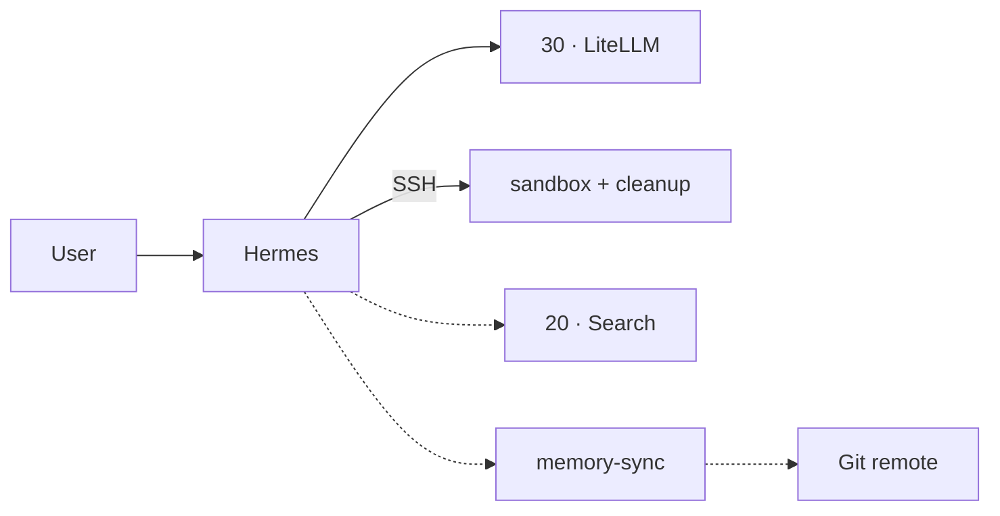

<!--
This Source Code Form is subject to the terms of the Mozilla Public
License, v. 2.0. If a copy of the MPL was not distributed with this
file, You can obtain one at https://mozilla.org/MPL/2.0/.
-->

# Stack 60 — Hermes

[Reading guide](../README.md#reading-guide) · [Operations](../docs/operations.md) · Next: [Stack 20 · SearXNG + Firecrawl](../stack-20_-_searxng_firecrawl/README.md)

The Hermes agent. It reaches models through LiteLLM, runs commands in an isolated SSH sandbox, and can optionally use web search and a Git-backed memory.



| | |
| --- | --- |
| Install requires | Stacks 00 and 30, **`litellm` running**, and dedicated `LITELLM_API_KEY` and `LITELLM_MCP_API_KEY` in `.env` |
| Containers | `hermes`, `hermes-sandbox`, `hermes-sandbox-cleanup`; optional `hermes-memory-sync` (Compose project `Stack6 - Hermes`) |
| Published at | `norai.casa.lan` → dashboard on port 9119, with basic auth (`HERMES_DASHBOARD_*`) |
| Runtime data | `${BASE_PATH}/${HERMES_SERVICE}`, `${HERMES_MEMORY_SERVICE}`, `${MEMORY_SYNC_SERVICE}`, `${SANDBOX_SERVICE}` |
| `status` | Hermes `/health`, sandbox `sshd`, cleanup state files; memory-sync (if active) has a Git checkout |

## Lifecycle specifics

- **Gateway credentials.** Create an inference key and a separate MCP key in LiteLLM, grant each the required access, and place both in the protected root `.env` before `install`. Set `HERMES_MODEL` to a model name actually exposed by LiteLLM; the template value is only an example. The CLI rejects missing or placeholder keys before a fresh `install` or `start`, but does not test their permissions or a model completion. A locked `install` is a no-op; `start` still checks the keys.
- **Telegram.** Set `TELEGRAM_BOT_TOKEN` and a comma-separated `TELEGRAM_ALLOWED_USERS` list of numeric user IDs in the protected root `.env`, then run `./local-ai stack-60 start`. `start` rejects a token without an allowlist before changing the runtime. No interactive Hermes setup or inbound webhook is needed; verify with a message from an allowed user.
- **`reconfig`** previews managed `config.yaml` and runtime environment drift. `reconfig --apply` stages changes from `.env` (including `HERMES_MODEL`), preserves the current web-tool choice, and removes stale central overrides from runtime `data/.env`. It backs up changed files but never changes container state. Activate with `./local-ai stack-60 stop` and `./local-ai stack-60 start`. `start` retains its existing gateway-drift safety check.
- **`stop`** includes the `git-memory` profile, so the memory-sync container is removed as well. A plain `docker compose down` would leave it running.
- **Isolation.** Hermes has no Docker socket. Commands run in the sandbox, which is attached only to the private `hermes-exec` network.
- **Sandbox file writes.** Compose sets `HERMES_WRITE_SAFE_ROOT=/opt/data:/workspace` in Hermes so the file-tool guard permits the SSH workspace as well as Hermes' existing state root. `/workspace` is writable in the sandbox; file tools use the configured SSH backend. After recreating Hermes, verify a file with `write_file` and `read_file` in a new session. Writing through `terminal` alone does not verify the file-tool guard.

## Gitea credentials in the SSH sandbox

Set these in the protected root `.env` (the URL defaults to Stack 40's
`GITEA_ROOT_URL`; the username and PAT are optional):

```dotenv
GITEA_URL=${GITEA_ROOT_URL}
GITEA_USERNAME=your-service-user
GITEA_TOKEN=your-scoped-personal-access-token
```

Compose supplies them to **Hermes**, whose native `terminal.env_passthrough`
forwards them using SSH `SendEnv`. The sandbox's `sshd` accepts exactly these
three Gitea names with `AcceptEnv`. This keeps `terminal.backend: ssh` and
requires no Hermes code or installation changes. Commands in the sandbox can
read the PAT; grant only the permissions they need. This exposes credentials
to tools, but does not automatically configure Git HTTPS authentication.
Git-memory synchronization continues to use its separate SSH identity.

The managed agent config is `${BASE_PATH}/${HERMES_SERVICE}/config/config.yaml`,
mounted at `/opt/data/config.yaml` in Hermes. The sandbox home is
`${BASE_PATH}/${SANDBOX_SERVICE}/data/home`, mounted at `/home/agent`; with the
template defaults its `.hermes` directory is
`/opt/docker/runtime/service_-_hermes-sandbox/data/home/.hermes` on the host.
Hermes uses that remote directory for skills and other execution assets.
Placing a `config.yaml` there does not configure the agent. Likewise,
`docker_forward_env` applies to Hermes' Docker backend, not this SSH backend.

For an existing deployment, update the checkout on the container host, add the
variables to its `.env`, then run as root from the checkout:

```sh
./local-ai stack-60 reconfig
./local-ai stack-60 reconfig --apply
./local-ai stack-60 stop
./local-ai stack-60 start
```

`reconfig --apply` stages the managed config; `start` builds the changed sandbox
image and recreates containers as needed. A locked `install` does not apply
these changes. No additional sandbox config file is needed.

Verify from a **Hermes terminal tool call** in a fresh session, rather than
`docker exec` (the values arrive over SSH). Check only that all three variables
are nonempty; never print the PAT. Then make an authenticated request to
`${GITEA_URL%/}/api/v1/user` and confirm the returned login matches
`GITEA_USERNAME`, without logging the token. Git operations need a separate
authentication check. The sandbox only joins `hermes-exec`, so use an endpoint
reachable from that network; the `gitea` container name on `redlocal` will not
resolve through the sandbox's network. For HTTPS, the sandbox must trust the
server certificate; install the local CA through a managed image or mount if
needed, and keep certificate verification enabled.

Implementation verified against the pinned release's
[SSH backend](https://github.com/NousResearch/hermes-agent/blob/v2026.9.21/tools/environments/ssh.py)
and [passthrough configuration loader](https://github.com/NousResearch/hermes-agent/blob/v2026.9.21/tools/env_passthrough.py).
Live SSH forwarding, Gitea authentication, DNS/routing and TLS trust must still
be verified on the container host.

## Optional features (manual scripts)

Run them from this directory as root, after `install`. None of them runs automatically.

- **Web tools:** start Stack 20, then run `reconcile-capabilities.py --restart`.
- **Git memory:** run in order `prepare-git-memory.py` (with Hermes stopped), then `prepare-maintenance-sidecars.py` (after placing the SSH key in `${MEMORY_SYNC_SERVICE}/ssh`), then `reconcile-capabilities.py --enable-git-memory --restart`.

| Script | Purpose |
| --- | --- |
| `reconcile-capabilities.py [--restart] [--enable-git-memory\|--disable-git-memory]` | Turn web tools on when `searxng` and `firecrawl-api` are reachable (off otherwise), and record the Git-memory choice |
| `prepare-git-memory.py` | Adopt the Git working tree (`GITMEM_REPOSITORY`, `GITMEM_BRANCH`) as memory without overwriting local changes |
| `prepare-maintenance-sidecars.py` | Check the memory-sync SSH material (`ssh_config`, `id_ed25519`, `known_hosts`) and its directories |
| `install-buzz.py` | Build and install the pinned Buzz CLI into Hermes' persistent data |
| `apply-terminal-timeout-workaround.py` | Patch a known Hermes terminal-timeout issue in the runtime code |
| `wait-ready.py` | Wait until the containers are ready after `start` |
| `cleanup.py [--reset-sandbox\|--reset-state\|--factory-reset] [--dry-run] [--yes]` | Clean up the runtime; the reset modes are destructive and ask for confirmation |

## Memory sync rules

The sidecar uses its own SSH identity, never force-pushes, stops when the branch has diverged, and commits only `MEMORY.md` and `USER.md`. That Git repository is the durable copy of the agent's memory; everything else in the sandbox can be rebuilt.

Files: `docker-compose.yml`, `config/` (Hermes config, sandbox, cleanup and memory-sync images, Buzz build), `01-prepare.py`, and the scripts above.
